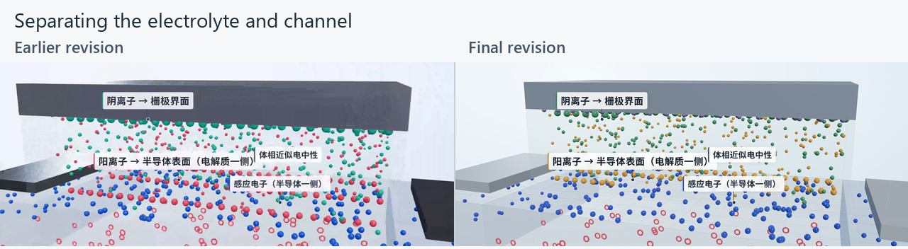

# An AI-Assisted Workflow for Creating Scientific Animations

[中文](README.zh-CN.md)

**Turning scientific concepts into short, code-driven films.** This project combines human scientific framing, creative direction and review with AI-assisted implementation. Finished animations, editable source and production notes show how an explanation becomes a visual work.

**The approach:** understand the mechanism → design the visual explanation → review and revise → render from code.

## First film · Electric-double-layer gating

### [▶ Watch the full film](https://lix-works.github.io/Scientific-Animation-Workflow/gallery/index.html#film) · [Download MP4](https://github.com/LiX-Works/Scientific-Animation-Workflow/releases/download/edl-v5/edl-gating-v5.mp4)

**FULL FILM · 2:26 · 1080p / 30 fps · Music & sound effects**  
Chinese on-screen graphics, with optional English explanation subtitles. The animation above is a short, silent preview; the selected full-quality film is 95.48 MB.

**The question:** how can a larger gate capacitance achieve the same change in channel charge at a lower gate voltage?

The film follows one device from a two-dimensional cross-section into a three-dimensional electrolyte interface, then returns to compare two gating schemes. It explains established course physics through a continuous visual narrative.

**Ion redistribution → closely separated interface charges → larger effective capacitance → less gate voltage for the same ΔQ.**

The comparison does not imply weaker local interface fields or a higher intrinsic material breakdown strength. Geometry, particles, field lines and the defect path are explanatory illustrations.

## How review shaped the result

The creator organized the scientific content, set the visual direction and reviewed successive versions. A web GPT conversation helped develop the brief; Grok Bot assisted with scene code, captions, synthesized music and sound effects, and rendering. Human review connected the scientific meaning to concrete changes in the film.

*An example of actionable review: cut back the upper electrolyte, reveal the interface grid, and separate charge colors. These frames show the corresponding narrative phase in two revisions.*

| A production decision | What changed in the film |
| --- | --- |
| **Give the camera a physical purpose.** An early 5:40 narration-led version felt like presentation slides. | A new 1–3 minute brief followed one device through 2D → 3D → the microscopic interface, with text and sound supporting its motion. |
| **Separate overlapping physical regions.** The electrolyte hid the interface and channel. | A front cutaway, interface grid and distinct charge colors made the spatial relationship easier to read. |
| **Keep clarity while tightening the pace.** Long reading intervals and glare interrupted the explanation. | Revised captions, camera timing, materials and sound produced a 2:26 film, with more visible schematic breakdown. |

These are decisions from this case, not fixed settings for every animation. Further films can explore other principles, devices and applications.

## From scientific explanation to editable implementation

| Frame the science | Direct and review | Implement and render |
| --- | --- | --- |
| Distinguish gate control from source–drain transport. Compare the same target charge, and state the limits of the failure-risk argument. | Write a visual brief, inspect frames and sequences, and turn observations about depth, color and timing into specific changes. | Use time-driven Three.js scenes and DOM captions, Puppeteer frame capture, NumPy/SciPy sound synthesis and FFmpeg encoding. |

In the EDL case, **a shared story-to-film timeline keeps captions, camera motion and sound events aligned**. Frames can be generated at chosen times; source and rendering tools are included so the work can be inspected and modified.

<strong>Source, production notes and reproduction details</strong>

- [EDL case and scientific scope](films/edl-gating/README.md)
- [Creative brief and review excerpts](films/edl-gating/docs/prompts.md)
- [Production history and revisions](films/edl-gating/docs/production-notes.md)
- [Rendering instructions](films/edl-gating/docs/rendering.md) and [executed checks](docs/validation.md)
- [Expanded workflow](docs/workflow.md) and [adding another case](docs/adding-a-case.md)
- [Four-scene overview](assets/edl-overview.jpg)

The supplied full film has 4,383 frames. The updated tools cover the complete scene; full-film re-rendering and exact historical output equivalence have not been established. The production tools are recorded; the specific model backend is not. Full private conversations and local environments are excluded.

Code: [MIT](LICENSE) · Original films, audio, images and writing: [CC BY 4.0](LICENSE-MEDIA.md) · [Sources and credits](THIRD_PARTY_NOTICES.md)
