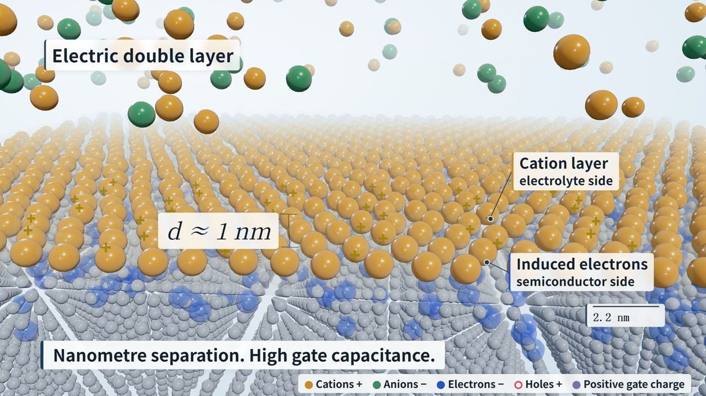

# AI 辅助的科学动画制作工作流

[English](README.md)

**把科学概念变成代码驱动的短片。** 本项目结合人工科学整理、创作方向与审片判断，以及 AI 辅助实现，保存成片、可修改源码和制作过程，让读者看到一段科学解释怎样形成视觉作品。

**整体方法：**理解机制 → 设计视觉解释 → 审片与修改 → 代码渲染。

## 首部影片 · 电双层栅控

### [▶ 观看完整影片](https://lix-works.github.io/Scientific-Animation-Workflow/gallery/index.html#film) · [下载 MP4](https://github.com/LiX-Works/Scientific-Animation-Workflow/releases/download/edl-v6/edl-gating-v6.mp4)

**完整影片 · 1 分 25 秒 · 1080p / 30 fps · 配乐与音效**

当前画面使用英文，并提供可选英文字幕。上方是无声短预览；完整高清版本为 111.88 MB。[较早的中文版本](https://github.com/LiX-Works/Scientific-Animation-Workflow/releases/tag/edl-v5)继续保留。

**创作背景：**题目来自本科传感器课程中的一个知识点，并非课程作业。受近期 Claude Opus 程序化影片热潮的启发，创作者把它当作自主项目，用来探索 AI 辅助的科学动画制作，过程中甚至推翻了完整的第一版，从头重建（见下文）。

**要解释的问题：为什么更大的栅电容，能够用更低的栅压实现相同的沟道电荷变化？**

影片沿同一器件，从二维剖面进入三维电解质界面，再回到宏观比较两种栅控方式，用连续的视觉叙事解释课堂中已有的物理知识。

**离子重排 → 界面电荷近距离分离 → 有效电容增大 → 相同 ΔQ 所需栅压降低。**

这不代表界面局部电场一定较弱，也不代表材料本征击穿强度提高。器件比例、粒子、场线和缺陷通路均用于解释性示意。

## 审片判断怎样改变作品

创作者组织科学内容、确定视觉方向，并审看各轮作品；网页版 GPT 协助整理创作委托，Grok Bot 协助最初的实现，后续使用 Codex 调整英文画面、运镜、材质、场线、节奏与程序化音频。人工审片把物理表达落实到具体画面修改。

*审片针对具体可见问题：局部剖切上层电解质、区分电荷颜色和标签、让界面两侧清楚可辨。[制作记录中的历史版本对照](films/edl-gating/docs/production-notes.md)继续保留。*

| 制作中的判断 | 对成片的改变 |
| --- | --- |
| **让镜头承担解释任务。** 早期约 5 分 40 秒的旁白版本过于接近演示幻灯片。 | 重新以 1–3 分钟为范围，组织“二维 → 三维 → 微观界面”的连续旅程，让文字和声音配合运动。 |
| **分开重叠的物理区域。** 电解质体相遮挡界面和沟道，空间关系难以辨认。 | 对前侧局部剖切，加入界面网格，并区分不同电荷的颜色。 |
| **提速时保留清晰度。** 阅读停顿与强反光打断了视觉解释。 | 85 秒英文版采用哑光材质、清楚的正侧面明暗、连续起转、错位流动场线及协调的音效。 |

这些是该案例的具体选择，而不是所有影片必须采用的参数。后续可以继续解释其他科学原理、器件与应用。

## 从科学解释到可修改的实现

| 科学内容整理 | 创作方向与审片 | 实现与渲染 |
| --- | --- | --- |
| 区分栅控和源漏输运，比较相同目标电荷，并交代失效风险结论的边界。 | 形成视觉委托，审看画面和运动，将空间、颜色与节奏问题变成具体修改。 | 用 Three.js 场景、DOM 字幕、Puppeteer 截帧、NumPy/SciPy 声音合成与 FFmpeg 编码连接制作环节。 |

本片通过**共享的故事时间与影片时间映射，对齐字幕、镜头运动和声音事件**。可以单独生成指定时刻的画面；源码和工具一并提供，方便检查和继续修改。

<strong>源码、制作记录与复现说明</strong>

- [EDL 案例与科学范围](films/edl-gating/README.md)
- [创作委托与审片意见选编](films/edl-gating/docs/prompts.md)
- [制作过程与版本修改](films/edl-gating/docs/production-notes.md)
- [渲染说明](films/edl-gating/docs/rendering.md)与[实际检查范围](docs/validation.md)
- [完整工作流](docs/workflow.md)与[新增案例](docs/adding-a-case.md)
- [四幕静态概览](assets/edl-overview.jpg)

当前成片共 2,550 帧，已按原生 1080p/30fps 完整渲染。源码、字幕时间及发布元数据一并提供；字体、浏览器与编码差异会影响重新生成的结果。较早 v5 及其历史记录继续保留。完整私人对话与本机环境不进入公开源码。

代码：[MIT](LICENSE) · 原创影片、音频、图片与说明：[CC BY 4.0](LICENSE-MEDIA.md) · [来源与致谢](THIRD_PARTY_NOTICES.md)
