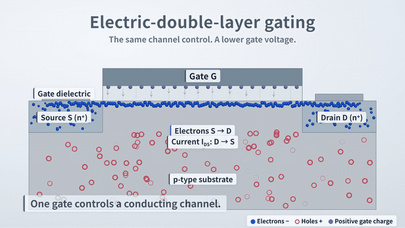
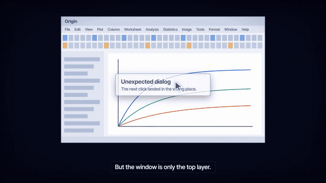

<table>
<tr>
<td width="50%"></td>
<td width="50%"></td>
</tr>
<tr>
<td><strong><a href="#edl">Electric-double-layer gating</a></strong> · 1:25 How can a larger gate capacitance reach the same channel charge at a lower gate voltage?</td>
<td><strong><a href="#mcp">MCP, Explained in Motion</a></strong> · 2:17 An AI model can only write text. How does it end up operating a program?</td>
</tr>
<tr>
<td><em>One continuous camera, from a flat device into its 3D interface.</em> Three.js, Puppeteer, NumPy/SciPy, with Grok Bot and Codex</td>
<td><em>Narration as the clock: every cue follows a spoken word.</em> Remotion, Canvas 2D, Node.js, ElevenLabs AI voice, with Claude Code</td>
</tr>
</table>

# Scientific Animation Workflow

[中文](README.zh-CN.md)

**Code-driven films that explain how something works.** Each film takes one mechanism, states what it does and does not claim, and explores one production technique. Finished film, editable source and method are published together.

## Electric-double-layer gating

**[▶ Watch](https://lix-works.github.io/Scientific-Animation-Workflow/gallery/index.html#film) · [Download MP4](https://github.com/LiX-Works/Scientific-Animation-Workflow/releases/download/edl-v6/edl-gating-v6.mp4) · [Read the case](../films/edl-gating/README.md)**

**Ion redistribution → closely separated interface charges → larger effective capacitance → less gate voltage for the same ΔQ.**

The film holds the target charge change fixed, so the gate voltage is the only question. It also keeps the limits on screen: a low external voltage can coexist with a strong local field, intrinsic breakdown strength does not rise, and electrochemical stability still applies. In `C = εA/d`, d is the separation of the interfacial charge layers, not the thickness of the electrolyte.

## MCP, Explained in Motion

**[▶ Watch](https://lix-works.github.io/Scientific-Animation-Workflow/gallery/index.html#mcp) · [Download MP4](https://github.com/LiX-Works/Scientific-Animation-Workflow/releases/download/mcp-v1/mcp-explained-v1.mp4) · [Read the case](../films/mcp-explained/README.md)**

**A program's window is only its top layer → an MCP server packages the interfaces below it as tools → the model reads the tool list and writes a request → the application sends it → the program does the work → the result returns as text, and the model writes the next request.**

The model never touches the software. MCP does not give AI control over a program either: control comes from the program's own interfaces, and the protocol standardizes how they are offered, so a program needs one server and every compatible application can use it.

## One method, two clocks

Both films are functions of time: every frame and every sound cue is computed from it, which makes them reproducible and easy to revise. They differ in what sets the clock.

| | Electric-double-layer gating | MCP, Explained in Motion |
|---|---|---|
| **The clock** | A story timeline mapped onto playback time | Word timestamps from the AI voice |
| **Best for** | A film carried by motion and on-screen text | A narrated film whose script is still changing |
| **What a revision costs** | Change the mapping to tighten the pace | Rewrite a line, and every later cue moves |

[The shared workflow](workflow.md) · [Narration as the clock](../films/mcp-explained/docs/method.md) · [Adding a case](adding-a-case.md) · [Executed checks](validation.md)

---

Code: [MIT](../LICENSE) · Original films, audio, images and writing: [CC BY 4.0](legal/LICENSE-MEDIA.md) · [Sources and credits](legal/THIRD_PARTY_NOTICES.md)
