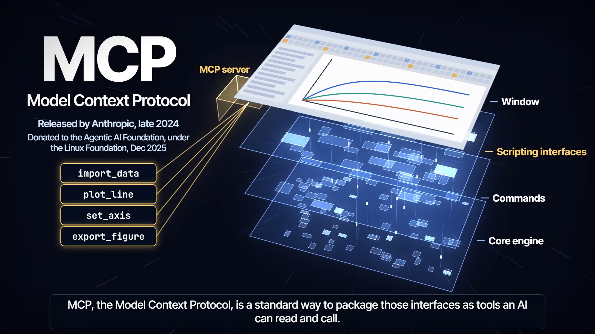

# MCP, Explained in Motion

**An AI model can only write text. How does it end up operating a program like Zotero or Origin?**

This 2:17 film follows one request from an application's window, down through the software's layers, and back. Its subject is the Model Context Protocol (MCP), the open standard that connects AI applications to other software.

**2:17 · 1080p / 60 fps · English captions · AI voice by ElevenLabs · Built with Claude Code and Remotion**

[Watch the film](https://lix-works.github.io/Scientific-Animation-Workflow/gallery/index.html#mcp) · [Download 1080p MP4](https://github.com/LiX-Works/Scientific-Animation-Workflow/releases/download/mcp-v1.0.1/mcp-explained-v1.0.1.mp4) · [The method](docs/method.md)

## The mechanism

**A program's window is only its top layer → below it are scripting interfaces, commands and the core engine → an MCP server packages those interfaces as tools → the model reads the tool list and writes a request → the application sends it as `tools/call` → the program does the work → the result returns as text → the model reads it and writes the next request.**

## What MCP is, and what it is not

| A common assumption | What actually happens |
|---|---|
| The model operates the software. | The model only writes text. The application reads that text and sends the call, and the server runs it. |
| MCP gives AI control over a program. | Control comes from the program's own interfaces and the code wrapped around them. MCP standardizes how that capability is offered, so a program needs one server and every compatible application can use it. |
| Tools are built into the AI. | Tools are discovered at run time and arrive as text: a name, a description and the inputs. The description is the interface the model reads, and every definition occupies context. |
| A failed call stops the task. | Execution errors return as ordinary results (`isError: true`), so the model can read what went wrong and correct its next call. |
| A session starts with a handshake. | Not since revision 2026-07-28. There is no `initialize` handshake: each request carries its own protocol version and capabilities. |

## Design decisions

| Decision | Reason |
|---|---|
| **Open on the layers, and leave the case for a standard until the end.** | A viewer cannot value a standard before seeing what it connects. Reuse lands in one sentence once the loop is clear. |
| **Use a task whose second step depends on the first.** Find a paper, then save it by DOI. | In a plotting task the steps run in a fixed order, so reading the results looks optional. Here the model cannot continue without reading. |
| **Show one failed call.** | Everything returning as text is easy to say and hard to believe. An error the model reads and corrects makes it visible. |
| **Tie every effect to an event.** | Motion draws the eye. An effect that marks nothing competes with the explanation, so each one marks a message moving, the model reading, or a call failing. |

## The technique: narration as the clock

The AI voice is what makes this possible: each take returns character timestamps, and a changed line can be regenerated on its own. Those timestamps give the start of each of about 350 spoken words. About 50 story events are named after those words, and the picture and the soundtrack read the same event table. No scene holds a hand-typed time.

| Property | How it works | Consequence |
|---|---|---|
| **Timing follows the words** | `narration.json` → word timestamps → `timeline.json` → `events.mjs` | Rewriting a line moves every later cue. A cue whose word was edited out fails at build time. |
| **Frames depend only on time** | Each frame is computed from its time, with seeded randomness | 8,236 frames at 60 fps render in parallel, and any stretch can be re-rendered alone. |
| **Sound is synthesized and measured** | Score and effects are generated in Node.js with no samples, and the music dips under the voice | Above 1 kHz, where consonants sit, the voice measures 14–20 dB over the music on every line. |

The pipeline does not depend on the topic: new narration, new events and new scenes make a new film, while the timeline, mix and render scripts carry over. [The method](docs/method.md) walks through it.

## Working with a coding agent

The code was written with Claude Code, and the pipeline is designed around that. An agent works reliably when it can check its own output, so the film exposes checks it can run: contact sheets of chosen frames, a per-line clarity measurement, loudness, and a build that fails when a cue loses its word. The specification is read at the source, which is how the `initialize` change was caught. What an agent cannot perceive stays with the creator: the explanation itself, how the film sounds, and whether each shot teaches anything.

## Source

| Entry | Contents |
|---|---|
| [The method](docs/method.md) | How narration becomes timing, and how to use it for another film |
| [Accuracy and limits](docs/scope.md) | Sources, what the film simplifies, and what is illustrative |
| [Rendering](docs/rendering.md) | Requirements, commands and the checks that were run |
| [release.json](release.json) | Duration, frame count, sizes and SHA-256 of the released files |

**Credits:** concept, explanation and direction by the creator. **Reuse:** original code is MIT-licensed; original film, documentation and audio are offered under CC BY 4.0 where applicable rights exist. Attribute **Scientific Animation Workflow contributors**. Third-party components retain their own terms: [code license](../../LICENSE), [media/documentation license](../../docs/legal/LICENSE-MEDIA.md), [third-party notices](../../docs/legal/THIRD_PARTY_NOTICES.md).
